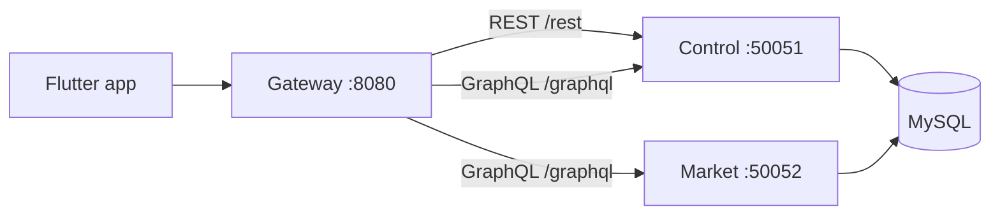
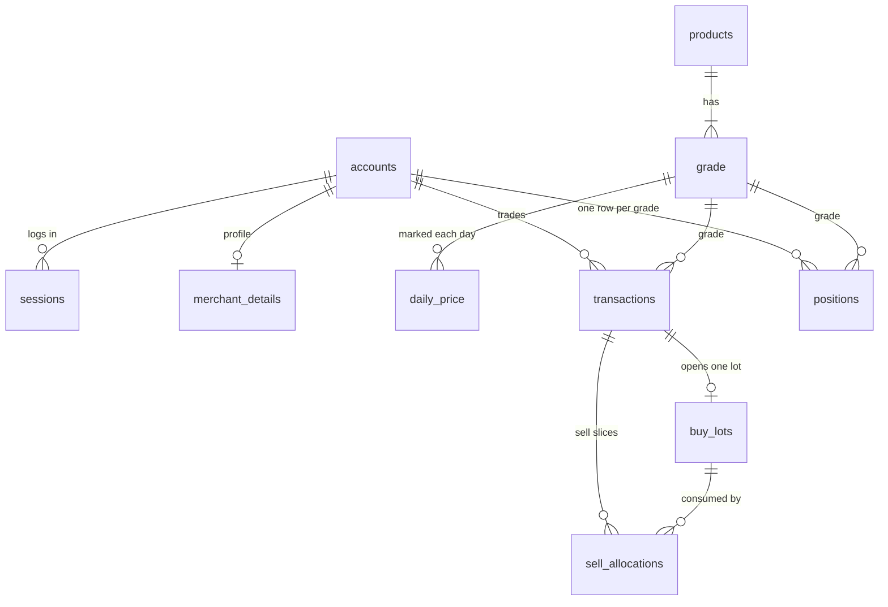
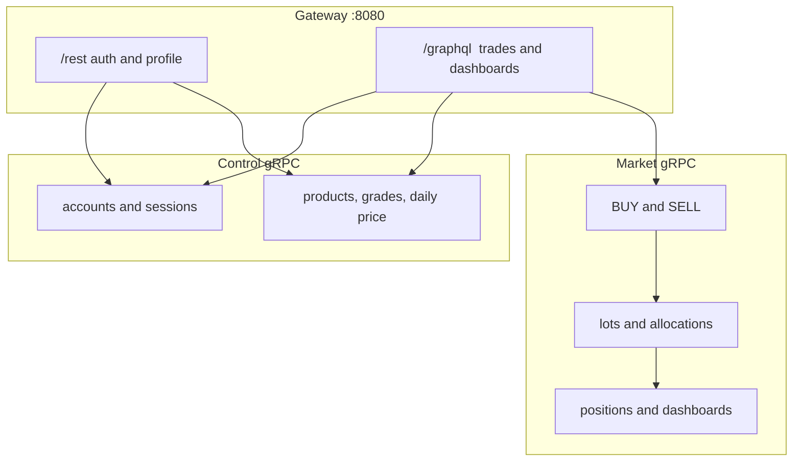
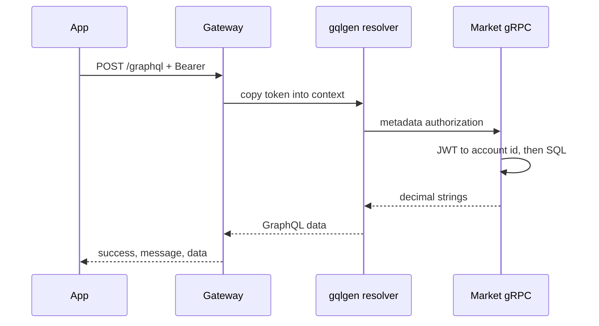
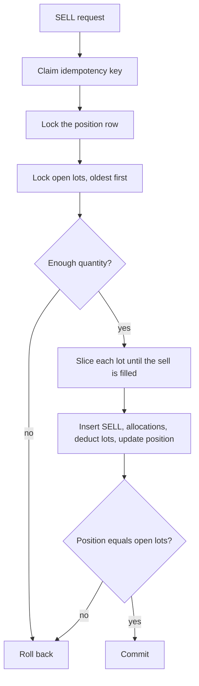
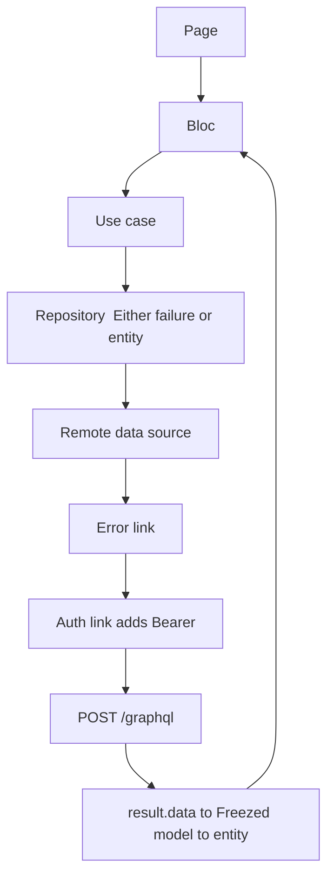
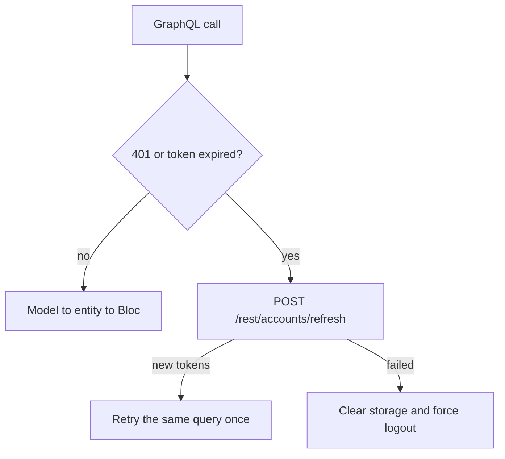

# SpiceLedger

Spice trading ledger. Merchants buy and sell spice grades. Inventory and profit use FIFO. One Flutter app, one HTTP gateway, two gRPC services, one MySQL database.



- **Control** owns accounts, sessions, products, grades, and the daily price.
- **Market** owns trades, FIFO lots, allocations, and positions.
- **Gateway** is the only process the app talks to.
- Auth stays on REST. Trading and dashboards are GraphQL.

---

## 1. Database

Two groups of tables share one MySQL database. Control writes the catalog. Market writes the ledger. Market reads `daily_price` for today's mark.



**Catalog**

- `accounts` — admin or merchant. Password is a bcrypt hash.
- `sessions` — access token, refresh token, device, revoked flag.
- `merchant_details` — one profile per account.
- `products` → `grade` — a spice and its grades.
- `daily_price` — one price per grade per calendar day. Used only to value open stock.

**Ledger**

- `transactions` — immutable BUY or SELL. Quantity and price never change after insert.
- `buy_lots` — one lot per BUY. `remaining_qty` falls as later sells consume it.
- `sell_allocations` — one row per lot a SELL touches. Stores that slice's realized P&L.
- `positions` — one aggregate per merchant and grade: quantity, cost, realized P&L.
- `idempotency_keys` — one row per merchant and client retry key, so a lost response cannot book the trade twice.

**Money columns**

- Quantity and unit price: `DECIMAL(18,4)`.
- Cost and P&L: `DECIMAL(38,8)`. The product of two 4-decimal numbers is stored exactly. It is not rounded in the ledger.
- Checks reject a negative lot, a negative position, and an allocation larger than the original lot.

**Invariant**

- `position.total_qty` = sum of open `remaining_qty`.
- `position.total_cost` = sum of `remaining_qty × lot price`.
- A read-only reconcile report finds a mismatch. It does not rewrite the row.

---

## 2. Services



- Gateway turns HTTP into gRPC. It does not hold business rules.
- A merchant JWT is the user id. The client cannot pick another merchant's id.
- An admin may pass a user id and can list every account.
- Control and market each run their own gRPC server. Both use the same MySQL.
- REST is login, refresh, logout, and merchant profile.
- GraphQL is catalog, buy, sell, positions, and the merchant dashboard.

| Path | Process | Upstream |
|---|---|---|
| `POST /rest/accounts/login` | gateway | control |
| `POST /graphql` | gateway | control and market |
| `/health`, `/ready` | gateway | none |

---

## 3. GraphQL

gqlgen. Schema and resolvers live in `gateway/graphql`. A resolver calls a gRPC client. It does not calculate FIFO.



- `Decimal` is a custom scalar. Responses are JSON strings, so `0.10` is not a float.
- Buy and sell take `quantity`, `price`, and an optional `idempotencyKey`. The same key and the same payload returns the original trade.
- The HTTP handler also accepts an `Idempotency-Key` header. The mutation argument wins.
- Errors from gRPC become a GraphQL error with `extensions.grpc_code`.
- The gateway then wraps the body so it matches REST:

```json
{ "success": true, "message": "", "data": { "merchantDashboard": {} } }
```

- `data` is the GraphQL payload. A GraphQL client can read it without a second unwrap.
- On failure, `success` is false, `data` is null, and the HTTP status follows the gRPC code. `Unauthenticated` is 401.

---

## 4. FIFO

Oldest open lot is sold first. Order is `trade_date`, then lot id. Lots are locked before they are consumed.

**Worked sell**

| Step | Lot | Action | Left on the lot |
|---|---|---|---|
| Buy | A | 100 kg @ 100 | 100 |
| Buy | B | 50 kg @ 110 | 50 |
| Buy | C | 80 kg @ 120 | 80 |
| Sell 120 kg @ 150 | A | take 100 | 0 |
| | B | take 20 | 30 |
| | C | take 0 | 80 |

- Remaining stock: 110 kg.
- Remaining cost: `(30 × 110) + (80 × 120) = 12,900`.
- Realized P&L: `(150 − 100) × 100 + (150 − 110) × 20 = 5,800`.
- Unrealized P&L is `today's price × quantity − remaining cost`. The displayed average is not fed back into that number.



- BUY, the new lot, and the position update commit in one transaction.
- SELL, every allocation, every lot deduction, and the position update commit in one transaction.
- The position is locked before the lots, so two sells of the same grade cannot take the same kilograms.
- A retried request with the same key does not insert a second trade.
- A failed attempt rolls the key back, so the merchant can retry it.

---

## 5. Mobile

Clean architecture. The widget never parses JSON. The data source is the only place that knows GraphQL.



- `GraphQLClient` is one singleton. Link order is error, then auth, then HTTP. A retry runs the auth link again, so the new token is attached.
- The access token is read from encrypted storage.
- `networkOnly` skips the GraphQL cache for dashboards and trades.
- The data source checks `result.hasException`, then reads `result.data['merchantDashboard']` (or the other root field) and builds a model.
- The repository maps the model to a domain entity and returns `Either<Failure, Entity>`.
- The bloc renders the entity. It does not see GraphQL field names.

**Session**



- One in-flight refresh is shared, so parallel queries do not refresh twice.
- Connection failures become a short message and a logout. Raw socket text is not shown.

**What the dashboard screen receives**

- Summary: portfolio value, cost, realized P&L, unrealized P&L, quantity.
- Holdings: one row per open grade, with weight in the portfolio.
- Trend points: daily realized P&L and the running total.
- Recent transactions and price movers.

Money on the wire is a decimal string. The current Freezed models cast those fields with `as num`, which expects a JSON number. A custom JSON converter is the matching piece on the app side for the `Decimal` scalar.
